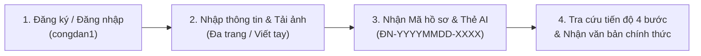
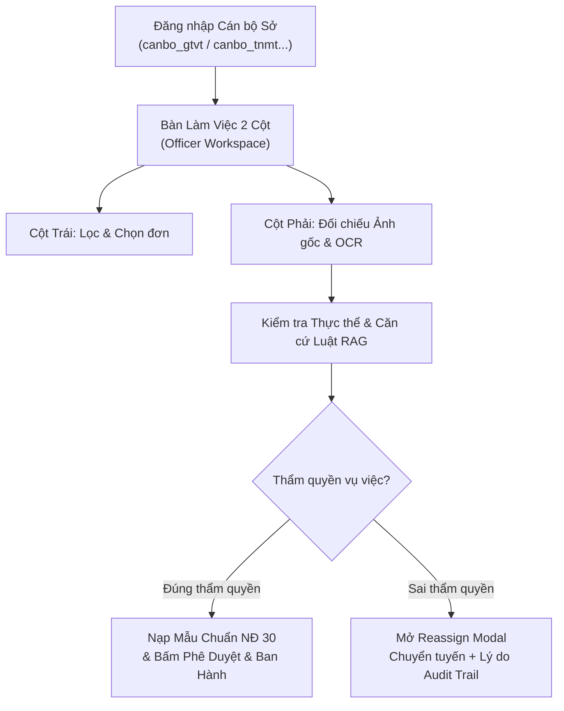
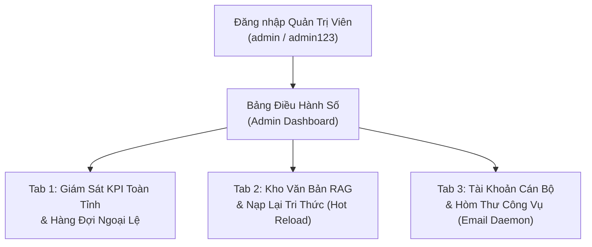

# CỔNG TIẾP NHẬN & PHÂN LUỒNG ĐƠN THƯ THÔNG MINH – TỈNH ĐỒNG NAI
## SỔ TAY HƯỚNG DẪN SỬ DỤNG VÀ VẬN HÀNH HỆ THỐNG
> **Dành cho: Công Dân / Doanh Nghiệp • Cán Bộ 8 Sở/Ngành & Một Cửa • Quản Trị Viên Toàn Hệ Thống**  
> *Áp dụng theo chuẩn Cổng Dịch vụ công Quốc gia & Thể thức văn bản hành chính Nghị định 30/2020/NĐ-CP*

---

## 📑 MỤC LỤC

1. [PHẦN 1: CÀI ĐẶT MÔI TRƯỜNG & KHỞI CHẠY HỆ THỐNG](#phần-1-cài-đặt-môi-trường--khởi-chạy-hệ-thống)
   - 1.1. [Yêu cầu hệ thống phần cứng và phần mềm](#11-yêu-cầu-hệ-thống-phần-cứng-và-phần-mềm)
   - 1.2. [Cấu hình biến môi trường (.env)](#12-cấu-hình-biến-môi-trường-env)
   - 1.3. [Khởi động nhanh 1-chạm (run.bat) & Tắt toàn bộ (stop.bat)](#13-khởi-động-nhanh-1-chạm-runbat--tắt-toàn-bộ-stopbat)
   - 1.4. [Khởi động thủ công từng phân hệ (Backend & Frontend)](#14-khởi-động-thủ-công-từng-phân-hệ-backend--frontend)
   - 1.5. [Danh mục 10 tài khoản kiểm thử nghiệp vụ (RBAC Test Accounts)](#15-danh-mục-10-tài-khoản-kiểm-thử-nghiệp-vụ-rbac-test-accounts)
2. [PHẦN 2: HƯỚNG DẪN DÀNH CHO CÔNG DÂN & DOANH NGHIỆP](#phần-2-hướng-dẫn-dành-cho-công-dân--doanh-nghiệp)
   - 2.1. [Đăng ký và Đăng nhập Cổng Dịch vụ công](#21-đăng-ký-và-đăng-nhập-cổng-dịch-vụ-công)
   - 2.2. [Nộp hồ sơ phản ánh, kiến nghị trực tuyến đa phương thức](#22-nộp-hồ-sơ-phản-ánh-kiến-nghị-trực-tuyến-đa-phương-thức)
   - 2.3. [Biên nhận điện tử & Thẻ AI Phân tích minh bạch](#23-biên-nhận-điện-tử--thẻ-ai-phân-tích-minh-bạch)
   - 2.4. [Tra cứu hành trình giải quyết hồ sơ theo thời gian thực (4 giai đoạn)](#24-tra-cứu-hành-trình-giải-quyết-hồ-sơ-theo-thời-gian-thực-4-giai-đoạn)
   - 2.5. [Theo dõi lịch sử đơn cá nhân](#25-theo-dõi-lịch-sử-đơn-cá-nhân)
3. [PHẦN 3: HƯỚNG DẪN DÀNH CHO CÁN BỘ THỤ LÝ (8 SỞ/NGÀNH & MỘT CỬA)](#phần-3-hướng-dẫn-dành-cho-cán-bộ-thụ-lý-8-sởngành--một-cửa)
   - 3.1. [Đăng nhập phân hệ Cán bộ chuyên trách](#31-đăng-nhập-phân-hệ-cán-bộ-chuyên-trách)
   - 3.2. [Bàn làm việc thông minh 2 cột (Officer Workspace)](#32-bàn-làm-việc-thông-minh-2-cột-officer-workspace)
   - 3.3. [Thẩm tra thực thể và đối chiếu căn cứ pháp lý địa phương](#33-thẩm-tra-thực-thể-và-đối-chiếu-căn-cứ-pháp-lý-địa-phương)
   - 3.4. [Soạn thảo và ban hành văn bản trả lời chuẩn Nghị định 30/2020/NĐ-CP](#34-soạn-thảo-và-ban-hành-văn-bản-trả-lời-chuẩn-nghị-định-302020nđ-cp)
   - 3.5. [Quy trình Chuyển tuyến hồ sơ sai thẩm quyền (Reassign Modal & Audit Trail)](#35-quy-trình-chuyển-tuyến-hồ-sơ-sai-thẩm-quyền-reassign-modal--audit-trail)
4. [PHẦN 4: HƯỚNG DẪN DÀNH CHO QUẢN TRỊ VIÊN TOÀN HỆ THỐNG (ADMIN)](#phần-4-hướng-dẫn-dành-cho-quản-trị-viên-toàn-hệ-thống-admin)
   - 4.1. [Đăng nhập và Giám sát Bảng điều hành số (Dashboard KPI)](#41-đăng-nhập-và-giám-sát-bảng-điều-hành-số-dashboard-kpi)
   - 4.2. [Điều phối Hàng đợi hồ sơ ngoại lệ (Exception Queue & Spam Filter)](#42-điều-phối-hàng-đợi-hồ-sơ-ngoại-lệ-exception-queue--spam-filter)
   - 4.3. [Quản trị Kho tri thức pháp luật quy phạm (RAG & Hot Reload)](#43-quản-trị-kho-tri-thức-pháp-luật-quy-phạm-rag--hot-reload)
   - 4.4. [Quản trị tài khoản cán bộ và Dịch vụ Hòm thư công vụ (Email Daemon)](#44-quản-trị-tài-khoản-cán-bộ-và-dịch-vụ-hòm-thư-công-vụ-email-daemon)
5. [PHẦN 5: XỬ LÝ SỰ CỐ & KHẮC PHỤC LỖI THƯỜNG GẶP (TROUBLESHOOTING)](#phần-5-xử-lý-sự-cố--khắc-phục-lỗi-thường-gặp-troubleshooting)

---

# PHẦN 1: CÀI ĐẶT MÔI TRƯỜNG & KHỞI CHẠY HỆ THỐNG

### 1.1. Yêu cầu hệ thống phần cứng và phần mềm

| Thành phần | Yêu cầu tối thiểu | Khuyến nghị (Khuyên dùng) |
| :--- | :--- | :--- |
| **Hệ điều hành** | Windows 10/11 (64-bit) hoặc Ubuntu 22.04 LTS | Windows 11 / Windows Server 2022 |
| **Vi xử lý (CPU)** | Intel Core i3 / AMD Ryzen 3 (4 Cores) | Intel Core i5 / AMD Ryzen 5 trở lên |
| **Bộ nhớ RAM** | 4 GB RAM | 8 GB - 16 GB RAM |
| **Môi trường Python** | Python 3.10 | Python 3.12 hoặc Python 3.14 |
| **Môi trường Node.js**| Node.js 18.x LTS | Node.js 20.x LTS hoặc 22.x LTS (kèm `npm 10+`) |
| **Cơ sở dữ liệu** | SQLite 3 (Tự sinh file `dongnai_civic.db`) | Microsoft SQL Server 2025 Express / SQL Server 2022 |

> [!NOTE]
> Hệ thống được lập trình với cơ chế kép: Nếu không cấu hình Microsoft SQL Server, hệ thống sẽ tự động khởi tạo cơ sở dữ liệu SQLite cục bộ `backend/dongnai_civic.db`, giúp kiểm thử ngay lập tức mà không cần cài đặt phần mềm quản trị CSDL phức tạp.

---

### 1.2. Cấu hình biến môi trường (.env)

Hệ thống quản lý biến môi trường tách biệt giữa Backend và Frontend:

#### 1. Cấu hình Backend (`backend/.env` hoặc `.env` tại thư mục gốc)
Tạo file `backend/.env` từ file mẫu `backend/.env.example`:
```ini
# Khóa Gemini AI (Google AI Studio hoặc Vertex AI)
GEMINI_API_KEY=AIzaSy... (hoặc AQ.Ab8RN...)

# Chuỗi kết nối Cơ sở dữ liệu (Bỏ trống hoặc đặt '#' để dùng SQLite mặc định)
# SQL_SERVER_CONNECTION_STRING=DRIVER={ODBC Driver 17 for SQL Server};SERVER=localhost\SQLEXPRESS02;DATABASE=DongNaiCivicDB;Trusted_Connection=yes;TrustServerCertificate=yes;

# Cấu hình Secret Key JWT cho xác thực người dùng
SECRET_KEY=dongnai-civic-router-super-secret-key-2026-production-ready
ACCESS_TOKEN_EXPIRE_MINUTES=1440

# Cấu hình Hòm thư tiếp nhận công vụ (Tùy chọn)
GMAIL_USER=tiepnhandonthu.dongnai@gmail.com
GMAIL_APP_PASSWORD=xxxx xxxx xxxx xxxx
```

#### 2. Cấu hình Frontend (`frontend/.env`)
Tạo file `frontend/.env` từ file mẫu `frontend/.env.example`:
```ini
# Để trống để sử dụng proxy cục bộ /api được định tuyến qua Vite (Khuyên dùng)
VITE_API_URL=
```

> [!IMPORTANT]
> Khi chạy cục bộ trên máy trạm, luôn giữ `VITE_API_URL=` (để trống). Vite sẽ tự động chuyển tiếp mọi yêu cầu HTTP có tiền tố `/api` đến cổng `http://127.0.0.1:8000` của FastAPI, tránh hoàn toàn lỗi mạng CORS hoặc sai lệch địa chỉ IP.

---

### 1.3. Khởi động nhanh 1-chạm (run.bat) & Tắt toàn bộ (stop.bat)

Hệ thống đã tích hợp sẵn 2 kịch bản tự động hóa cho hệ điều hành Windows tại thư mục gốc `D:\Code\DauTruongAI`:

#### 1. Khởi chạy toàn bộ hệ thống (`run.bat`)
- **Cách thực hiện:** Nhấp đúp chuột vào file [run.bat](file:///d:/Code/DauTruongAI/run.bat) hoặc mở PowerShell/CMD và gõ:
  ```cmd
  .\run.bat
  ```
- **Tiến trình tự động:**
  1. Mở cửa sổ 1: Kích hoạt môi trường ảo Python và khởi chạy Backend FastAPI trên cổng **8000**.
  2. Đợi 2 giây để Socket và Database sẵn sàng.
  3. Mở cửa sổ 2: Khởi chạy Frontend React Vite trên cổng **5173**.
- **Địa chỉ truy cập:**
  - **Cổng Dịch vụ công & Bàn làm việc:** `http://localhost:5173`
  - **Tài liệu API Swagger UI:** `http://localhost:8000/docs`
  - **Kiểm tra trạng thái Health Check:** `http://localhost:8000/health`

#### 2. Dừng khẩn cấp toàn bộ hệ thống (`stop.bat`)
- **Cách thực hiện:** Nhấp đúp chuột vào file [stop.bat](file:///d:/Code/DauTruongAI/stop.bat) hoặc gõ:
  ```cmd
  .\stop.bat
  ```
- Kịch bản sẽ tự động giải phóng sạch sẽ các tiến trình đang lắng nghe trên cổng 5173 và 8000, tránh tình trạng chiếm giữ cổng ngầm (Zombie process).

---

### 1.4. Khởi động thủ công từng phân hệ (Backend & Frontend)

Nếu muốn khởi động từng phân hệ trong cửa sổ dòng lệnh riêng để xem log chi tiết:

#### Cửa sổ 1: Khởi động Backend (FastAPI - Port 8000)
```powershell
cd D:\Code\DauTruongAI\backend
# Kích hoạt môi trường ảo (nếu có venv)
.\venv\Scripts\Activate.ps1
# Cài đặt thư viện (chỉ cần chạy lần đầu)
pip install -r requirements.txt
# Khởi chạy máy chủ API
python -m uvicorn main:app --reload --host 0.0.0.0 --port 8000
```

#### Cửa sổ 2: Khởi động Frontend (React 18 + Vite - Port 3000)
```powershell
cd D:\Code\DauTruongAI\frontend
# Cài đặt gói npm (chỉ cần chạy lần đầu)
npm install
# Khởi chạy máy chủ giao diện
npm run dev
```

---

### 1.5. Danh mục 10 tài khoản kiểm thử nghiệp vụ (RBAC Test Accounts)

Hệ thống thiết lập sẵn ma trận 10 tài khoản nghiệp vụ đại diện cho toàn bộ các bên liên quan trong quy trình hành chính công:

| STT | Đơn vị / Đối tượng | Tên đăng nhập | Mật khẩu | Vai trò (Role) | Phạm vi quyền hạn nghiệp vụ |
| :---: | :--- | :--- | :--- | :---: | :--- |
| **1** | **Quản trị viên Hệ thống** | `admin` | `admin123` | `ADMIN` | Toàn quyền kiểm soát hệ thống, Dashboard KPI toàn tỉnh, duyệt tài khoản cán bộ, xử lý đơn ngoại lệ, quản trị kho luật RAG |
| **2** | **Công dân / Doanh nghiệp** | `congdan1` | `citizen123` | `CITIZEN` | Nộp phản ánh trực tuyến, nhận biên nhận điện tử & Thẻ AI, tra cứu hành trình 4 bước, xem lịch sử đơn cá nhân |
| **3** | **Sở Giao thông Vận tải** | `canbo_gtvt` | `officer123` | `OFFICER` | Thụ lý đơn hạ tầng giao thông, đèn tín hiệu, đường xuống cấp, nứt lún cầu đường, điểm đen TNGT |
| **4** | **Sở Tài nguyên & Môi trường** | `canbo_tnmt` | `officer123` | `OFFICER` | Thụ lý đơn ô nhiễm nước thải KCN, bãi rác tự phát, tranh chấp quyền sử dụng đất, khai thác khoáng sản |
| **5** | **Sở Xây dựng** | `canbo_xaydung` | `officer123` | `OFFICER` | Thụ lý đơn công trình xây dựng sai phép, lấn chiếm vỉa hè, sụp lún do thi công, vi phạm trật tự xây dựng |
| **6** | **Sở Y tế** | `canbo_yte` | `officer123` | `OFFICER` | Thụ lý đơn cơ sở y tế tư nhân, vệ sinh an toàn thực phẩm, ngộ độc thức ăn tập thể, dịch bệnh y tế |
| **7** | **Sở Giáo dục & Đào tạo** | `canbo_gddt` | `officer123` | `OFFICER` | Thụ lý đơn cơ sở vật chất trường học, lạm thu đầu năm, vi phạm đạo đức nhà giáo, bạo lực học đường |
| **8** | **Sở Lao động - TB & XH** | `canbo_ldtbxh` | `officer123` | `OFFICER` | Thụ lý đơn nợ đọng lương công nhân KCN, vi phạm chính sách BHXH, tai nạn lao động, an sinh xã hội |
| **9** | **Công an Tỉnh Đồng Nai** | `canbo_congan` | `officer123` | `OFFICER` | Thụ lý đơn an ninh trật tự, trộm cắp, lừa đảo công nghệ cao, đua xe trái phép, karaoke gây mất trật tự ban đêm |
| **10**| **Bộ phận Một cửa / Cấp Huyện** | `canbo_motcua` | `officer123` | `OFFICER` | Thụ lý thủ tục hành chính công một cửa, chứng thực, hộ tịch, hòa giải tranh chấp cơ sở |

---

# PHẦN 2: HƯỚNG DẪN DÀNH CHO CÔNG DÂN & DOANH NGHIỆP



### 2.1. Đăng ký và Đăng nhập Cổng Dịch vụ công

1. Mở trình duyệt web truy cập địa chỉ: `http://localhost:5173`.
2. Màn hình đăng nhập xuất hiện:
   - Nếu đã có tài khoản: Nhập **Tên đăng nhập** (`congdan1`), **Mật khẩu** (`citizen123`), sau đó bấm **"Đăng Nhập Vào Hệ Thống"**.
   - Nếu chưa có tài khoản: Nhấp vào liên kết **"Đăng ký tài khoản công dân mới"** (`/register`), điền đầy đủ Họ và tên, Tên đăng nhập, Mật khẩu, Số điện thoại và Email. Tài khoản Công dân được hệ thống tự động kích hoạt ngay lập tức mà không cần phê duyệt thủ công.

---

### 2.2. Nộp hồ sơ phản ánh, kiến nghị trực tuyến đa phương thức

Sau khi đăng nhập thành công với vai trò Công dân, hệ thống chuyển hướng đến **Cổng Tiếp Nhận Ý Kiến, Kiến Nghị & Phản Ánh**. Tại tab mặc định **"Gửi Phản Ánh"**:

#### Bước 1: Nhập thông tin người gửi
- **Họ và tên người phản ánh:** Tự động điền theo thông tin tài khoản hoặc nhập tên người đại diện.
- **Số điện thoại liên hệ:** Dùng để nhận tin nhắn thông báo tiến độ.
- **Địa chỉ Email tiếp nhận:** Dùng để nhận văn bản phản hồi chính thức từ Sở/Ngành thụ lý.

#### Bước 2: Nhập nội dung vụ việc
- **Tiêu đề phản ánh:** Ghi ngắn gọn, rõ ràng (Ví dụ: *"Khói bụi và xả nước thải mùi hôi nồng nặc tại KCN Biên Hòa 2"*).
- **Địa điểm phát sinh sự việc:** Ghi cụ thể số nhà, tên đường, phường/xã, huyện/thành phố thuộc tỉnh Đồng Nai.
- **Nội dung chi tiết vụ việc:** Trình bày diễn biến sự việc, thời gian xảy ra, các dấu hiệu vi phạm và kiến nghị giải quyết.

#### Bước 3: Tải ảnh hiện trường hoặc trang đơn viết tay (Multimodal OCR)
- Nhấp vào khung tải ảnh hoặc kéo thả các tệp hình ảnh vào vùng nhận dạng (định dạng hỗ trợ: `PNG`, `JPG`, `JPEG`, `JFIF`).
- **Hỗ trợ đơn đa trang:** Cho phép chọn cùng lúc nhiều ảnh (ví dụ: Trang 1 nội dung đơn, Trang 2 chữ ký & hiện trường).
- Mỗi ảnh tải lên được hiển thị hình thu nhỏ (thumbnail) kèm dung lượng. Bạn có thể bấm nút **Xóa (thùng rác)** nếu chọn nhầm ảnh.
- Hệ thống tự động nén ảnh tối ưu trong RAM trình duyệt trước khi truyền tải, bảo đảm nộp nhanh kể cả trên mạng 4G/5G.

#### Bước 4: Cam đoan và Gửi đơn
- Tích chọn vào ô cam kết: *"Tôi xin cam đoan các thông tin phản ánh trên là đúng sự thật và chịu hoàn toàn trách nhiệm trước pháp luật"*.
- Bấm nút **"Gửi Phản Ánh Đến Cơ Quan Chức Năng"**.

---

### 2.3. Biên nhận điện tử & Thẻ AI Phân tích minh bạch

Ngay sau khi bấm nộp đơn (thời gian phản hồi chỉ dưới **0.5 giây**), hệ thống hiển thị **Hộp Thoại Biên Nhận Tiếp Nhận Điện Tử & Kết Quả Phân Tích AI**:

1. **Mã hồ sơ điện tử định chuẩn Quốc gia:**
   - Định dạng: `ĐN-YYYYMMDD-XXXX` (Ví dụ: `ĐN-20261120-4821`).
   - Có nút **"Sao Chép Mã"** nhanh để lưu trữ.
2. **Thẻ Trợ lý AI Phân tích & Điều phối:**
   - **Tỷ lệ tin cậy AI:** Hiển thị phần trăm độ tin cậy của thuật toán (ví dụ: `96%`).
   - **Cơ quan đề xuất tiếp nhận:** Hiển thị tên cơ quan thẩm quyền (ví dụ: `Sở Tài nguyên & Môi trường`).
   - **Mức độ ưu tiên:** Gán nhãn `CAO`, `TRUNG_BINH` hoặc `THAP`.
   - **Tóm tắt nội dung:** Đoạn tóm tắt bản chất sự việc do AI chắt lọc ngắn gọn, xúc tích.
   - **Lý do định tuyến:** Giải thích rõ ràng nguyên nhân tại sao hồ sơ được chuyển về đơn vị tương ứng.
   - **Căn cứ pháp luật viện dẫn:** Trích dẫn chính xác tên văn bản quy phạm pháp luật áp dụng (ví dụ: *Điều 162 Luật Bảo vệ Môi trường năm 2020*).
3. **Nút hành động nhanh:**
   - Bấm nút **"Xem Chi Tiết & Tra Cứu Tiến Độ Ngay"** để chuyển thẳng tới màn hình theo dõi hành trình.

---

### 2.4. Tra cứu hành trình giải quyết hồ sơ theo thời gian thực (4 giai đoạn)

Công dân có thể tra cứu tình trạng xử lý bất kỳ lúc nào bằng 2 cách:
- Bấm vào tab **"Tra Cứu Tiến Độ"** tại trang chủ hoặc vào trực tiếp đường dẫn `/tracking`.
- Nhập mã hồ sơ (Ví dụ: `ĐN-20261120-4821`) vào ô tìm kiếm và bấm **"Tra Cứu"**.

#### Màn hình hiển thị kết quả tra cứu:
1. **Thông tin cơ bản hồ sơ:** Mã hồ sơ, Ngày tiếp nhận, Nguồn gửi (Web/Email/Một cửa), Cơ quan đang thụ lý.
2. **Trục thời gian 4 giai đoạn giải quyết (Progress Timeline):**
   - **Giai đoạn 1: Tiếp nhận hồ sơ:** Đã ghi nhận vào hệ thống Cổng Dịch vụ công.
   - **Giai đoạn 2: Phân loại & Định tuyến:** Trí tuệ nhân tạo Gemini & RAG đã đối chiếu quy định và định tuyến về Sở chuyên trách.
   - **Giai đoạn 3: Đang thẩm định & Xử lý:** Cán bộ chuyên trách Sở đang kiểm tra hiện trường, thu thập chứng cứ và soạn văn bản trả lời.
   - **Giai đoạn 4: Hoàn tất & Ban hành:** Lãnh đạo Sở đã phê duyệt văn bản phúc đáp chính thức, gửi văn bản đến người dân qua email và hệ thống.
3. **Văn bản trả lời chính thức:**
   - Khi hồ sơ ở trạng thái `APPROVED`, hộp văn bản phản hồi sẽ hiển thị toàn văn công văn trả lời của cơ quan chức năng đúng chuẩn thể thức hành chính.

---

### 2.5. Theo dõi lịch sử đơn cá nhân

Nhấp vào tab **"Lịch Sử Gửi Đơn"** trên Cổng Công Dân:
- Hiển thị danh sách tất cả các đơn thư phản ánh mà tài khoản công dân hiện tại đã từng gửi.
- Cột thông tin bao gồm: Mã hồ sơ, Ngày gửi, Trích yếu nội dung tóm tắt, Cơ quan thụ lý, Trạng thái giải quyết (Huy hiệu màu trực quan).
- Mỗi dòng đơn có nút **"Tra cứu"** để mở nhanh chi tiết mà không cần nhập lại mã.

---

# PHẦN 3: HƯỚNG DẪN DÀNH CHO CÁN BỘ THỤ LÝ (8 SỞ/NGÀNH & MỘT CỬA)



### 3.1. Đăng nhập phân hệ Cán bộ chuyên trách

1. Truy cập `http://localhost:5173/login`.
2. Đăng nhập bằng tài khoản cán bộ tương ứng với đơn vị của mình (Mật khẩu chung cho tất cả cán bộ kiểm thử là: `officer123`):
   - Cán bộ Giao thông: `canbo_gtvt`
   - Cán bộ Tài nguyên Môi trường: `canbo_tnmt`
   - Cán bộ Xây dựng: `canbo_xaydung`
   - Cán bộ Y tế: `canbo_yte`
   - Cán bộ Giáo dục: `canbo_gddt`
   - Cán bộ Lao động Thương binh Xã hội: `canbo_ldtbxh`
   - Cán bộ Công an Tỉnh: `canbo_congan`
   - Chuyên viên Tiếp công dân: `canbo_motcua`
3. Sau khi xác thực thành công, hệ thống tự động đưa cán bộ vào giao diện chuyên biệt **Bàn Làm Việc Cán Bộ Thụ Lý** (`/officer`).

---

### 3.2. Bàn làm việc thông minh 2 cột (Officer Workspace)

Giao diện được thiết kế theo tỷ lệ chuẩn công thái học GovTech, chia thành 2 phân vùng độc lập giúp cán bộ thao tác liền mạch:

#### Thanh công cụ lọc phía trên (Filter Toolbar):
- **Bộ lọc Đơn vị:** Mặc định hệ thống tự khóa và chỉ hiển thị đơn thuộc thẩm quyền của Sở cán bộ đang công tác.
- **Bộ lọc Kênh tiếp nhận:** Lọc theo Đơn nộp qua Web, Đơn gửi qua Hòm thư Email, hoặc Đơn nộp trực tiếp tại Bộ phận Một cửa.
- **Bộ lọc Mức độ khẩn cấp:** Lọc các đơn `CAO` (cần xử lý ngay trong 24h), `TRUNG_BINH` hoặc `THAP`.
- **Thanh tìm kiếm:** Tìm nhanh theo Mã hồ sơ, Tên người dân hoặc từ khóa nội dung.
- **Nút "Làm mới dữ liệu":** Đồng bộ danh sách hồ sơ mới nhất từ máy chủ.

#### Cột bên trái: Danh sách hồ sơ thụ lý (Ticket Master List):
- Hiển thị danh sách các hồ sơ đang chờ xử lý hoặc đã duyệt.
- Thẻ hồ sơ tóm tắt gồm: Mã hồ sơ nổi bật font Monospace, huy hiệu mức độ khẩn cấp (Đỏ: Khẩn cấp/Cao, Vàng: Trung bình, Lam: Tiêu chuẩn), trích yếu sự việc, thời gian tiếp nhận và trạng thái hiện tại.
- Nhấp chuột vào một hồ sơ để nạp toàn bộ chi tiết sang Cột bên phải.

#### Cột bên phải: Vùng thẩm định chi tiết & Soạn thảo (Detail & Action Panel):
- Hiển thị đầy đủ thông tin người gửi, địa chỉ sự cố, nguồn tiếp nhận.
- **Phân khu xem ảnh hiện trường:** Hiển thị ảnh chụp đơn gốc, hỗ trợ phóng to (lightbox) để cán bộ đối chiếu từng nét chữ viết tay.
- **Văn bản bóc tách OCR:** Cán bộ có thể chỉnh sửa trực tiếp nội dung văn bản nếu ảnh chụp mờ nhòe gây thiếu sót từ ngữ.

---

### 3.3. Thẩm tra thực thể và đối chiếu căn cứ pháp lý địa phương

Tại Thẻ Phân Tích Trí Tuệ Nhân Tạo (AiAnalysisCard) ở cột phải:
- **Thực thể phát hiện:** Hệ thống tự động bóc tách các địa danh phát sinh (tên đường, ấp, khu phố, xã/phường, thành phố) và các từ khóa hành vi vi phạm.
- **Căn cứ pháp luật viện dẫn:** AI tự động truy xuất các điều khoản quy phạm pháp luật tỉnh Đồng Nai đang có hiệu lực thi hành liên quan trực tiếp đến vụ việc. Cán bộ đối chiếu nhanh với quy chuẩn chuyên ngành mà không cần mở sách luật tra cứu thủ công.

---

### 3.4. Soạn thảo và ban hành văn bản trả lời chuẩn Nghị định 30/2020/NĐ-CP

Khung soạn thảo phản hồi tích hợp sẵn công cụ hỗ trợ chuẩn hóa văn bản hành chính nhà nước:

1. **Nút "Nạp Mẫu Chuẩn Nghị Định 30":**
   - Khi bấm nút này, hệ thống tự động điền mẫu công văn hành chính chuẩn thức vào ô soạn thảo:
   ```text
   ỦY BAN NHÂN DÂN TỈNH ĐỒNG NAI          CỘNG HÒA XÃ HỘI CHỦ NGHĨA VIỆT NAM
   [TÊN CƠ QUAN BAN HÀNH]                       Độc lập - Tự do - Hạnh phúc
   Số: ......./CV-[TÊN CƠ QUAN]                 Đồng Nai, ngày ... tháng ... năm 2026

                      PHIẾU TRẢ LỜI PHẢN ÁNH, KIẾN NGHỊ
              Kính gửi: Ông/Bà [Họ và tên người phản ánh]

   Căn cứ: [Căn cứ pháp lý do AI đối chiếu từ kho RAG]
   Sau khi xem xét nội dung đơn phản ánh mã số [Mã hồ sơ] về việc [Nội dung],
   [Tên cơ quan ban hành] xin thông báo kết quả giải quyết như sau:
   1. Về hiện trạng kiểm tra xác minh: ...
   2. Biện pháp xử lý và phương án giải quyết: ...

   Nơi nhận:                                  THỦ TRƯỞNG ĐƠN VỊ
   - Như trên;                                 (Ký, ghi rõ họ tên và đóng dấu)
   - Lưu: VT.
   ```
2. **Hiệu chỉnh nội dung:** Cán bộ hoàn thiện các thông tin kiểm tra hiện trường thực tế, kết luận xử lý hoặc thời hạn khắc phục.
3. **Phê duyệt & Ban hành:**
   - Bấm nút **"Phê Duyệt & Ban Hành Văn Bản"**.
   - Trạng thái hồ sơ lập tức chuyển thành `APPROVED`.
   - Hệ thống tự động phát hành email công vụ thông báo toàn văn kết quả xử lý đến địa chỉ hộp thư của người dân (nếu có email).

---

### 3.5. Quy trình Chuyển tuyến hồ sơ sai thẩm quyền (Reassign Modal & Audit Trail)

Trong trường hợp người dân gửi đơn nhầm lĩnh vực hoặc AI định tuyến cần điều chỉnh:

1. Tại cột phải, bấm nút **"Chuyển Tuyến Đơn Vị Khác"** (biểu tượng mũi tên hai chiều).
2. Hộp thoại **"Chuyển Tuyến Đơn Vị Thụ Lý"** xuất hiện:
   - **Đơn vị tiếp nhận mới:** Chọn 1 trong 7 Sở/Ngành hoặc Bộ phận Một cửa huyện tương ứng.
   - **Lý do chuyển tuyến:** Bắt buộc nhập lý do (Ví dụ: *"Nội dung đơn liên quan đến việc thi công nhà ở gây nứt tường, thuộc thẩm quyền cấp phép và thanh tra của Sở Xây dựng"*).
3. Bấm nút **"Xác Nhận Chuyển Tuyến"**.
4. **Vết kiểm toán (Audit Trail):**
   - Hệ thống ghi nhận dấu vết vào trường `admin_note`: Thời gian chuyển, tài khoản cán bộ thực hiện, đơn vị chuyển đi, đơn vị tiếp nhận và nguyên văn lý do chuyển.
   - Hồ sơ được chuyển tức thì sang danh sách thụ lý của Sở mới, hoàn toàn minh bạch trách nhiệm xử lý công vụ.

---

# PHẦN 4: HƯỚNG DẪN DÀNH CHO QUẢN TRỊ VIÊN TOÀN HỆ THỐNG (ADMIN)



### 4.1. Đăng nhập và Giám sát Bảng điều hành số (Dashboard KPI)

1. Đăng nhập với tài khoản: `admin` / `admin123`.
2. Hệ thống chuyển tới giao diện điều hành số tập trung `/admin`.
3. **6 Thẻ chỉ số KPI tiếp nhận toàn tỉnh (Cập nhật Realtime):**
   - **Tổng Số Hồ Sơ Tiếp Nhận:** Tổng dung lượng đơn thư trên toàn bộ các kênh.
   - **Đã Phân Luồng Tự Động:** Tỷ lệ hồ sơ được AI phân loại thành công ngay tức thì (mục tiêu đạt trên 95%).
   - **Hồ Sơ Khẩn Cấp (Cấp Độ CAO):** Số lượng vụ việc cháy nổ, sạt lở, tai nạn, ngộ độc cần xử lý hỏa tốc.
   - **Đang Thụ Lý Tại Sở/Ngành:** Khối lượng đơn thư các Sở đang trong quá trình xác minh, kiểm tra.
   - **Đã Giải Quyết & Ban Hành:** Số công văn chính thức đã phát hành đến tay người dân.
   - **Hàng Đợi Ngoại Lệ (Cần Phê Duyệt):** Đơn thư có độ tự tin thấp hoặc có xung đột thẩm quyền cần Admin can thiệp.
4. **Biểu đồ phân bổ Sở/Ngành:** Trực quan hóa tỷ trọng đơn thư giữa các Sở GTVT, TN&MT, Xây dựng, Y tế, Giáo dục, Lao động, Công an và Một cửa.

---

### 4.2. Điều phối Hàng đợi hồ sơ ngoại lệ (Exception Queue & Spam Filter)

Tại tab **"Giám Sát Hệ Thống & Hàng Đợi Điều Phối"**:
- Danh sách các hồ sơ mang cờ `REQUIRE_HUMAN_REVIEW` (đơn mờ nhòe không đủ thông tin, đơn nặc danh hoặc độ tin cậy AI < 65%).
- Quản trị viên đọc chi tiết nội dung sự việc và thực hiện 1 trong 2 thao tác:
  1. **Chỉ định Sở thẩm quyền:** Chọn đơn vị thụ lý chính xác và bấm **"Điều Phối Về Sở"**.
  2. **Đánh dấu thư rác (Mark as Spam):** Đối với các đơn quảng cáo, nội dung bôi nhọ vô căn cứ hoặc nội dung phá hoại hệ thống. Hồ sơ sẽ được đóng lại và lưu trữ riêng.

---

### 4.3. Quản trị Kho tri thức pháp luật quy phạm (RAG & Hot Reload)

Tại tab **"Kho Văn Bản Quy Phạm Pháp Luật"**:
- Quản lý danh mục các văn bản quy phạm pháp luật địa phương đang được AI sử dụng làm căn cứ đối chiếu.
- **Thêm văn bản luật mới:**
  - Nhập **Tiêu đề văn bản** (Ví dụ: *Quyết định số 28/2024/QĐ-UBND về bồi thường, hỗ trợ tái định cư tỉnh Đồng Nai*).
  - Chọn **Lĩnh vực phụ trách** (Giao thông, Môi trường, Xây dựng, Đất đai, Y tế...).
  - Dán **Nội dung quy định/điều khoản trọng tâm**.
  - Bấm **"Lưu Văn Bản Pháp Lý"**.
- **Tính năng "Nạp Lại Tri Thức / Hot Reload RAG":**
  - Bấm nút **"Nạp Lại Tri Thức"** (biểu tượng làm mới).
  - Hệ thống tự động vector hóa và cập nhật dữ liệu tri thức mới trực tiếp vào bộ nhớ RAM của dịch vụ AI chỉ trong 1-2 giây mà **hoàn toàn không cần khởi động lại máy chủ Backend**.

---

### 4.4. Quản trị tài khoản cán bộ và Dịch vụ Hòm thư công vụ (Email Daemon)

Tại tab **"Tài Khoản & Phân Quyền Cán Bộ"**:
- **Duyệt tài khoản Cán bộ mới:** Khi cán bộ các Sở đăng ký tài khoản từ Cổng ngoài, tài khoản sẽ ở trạng thái chờ duyệt. Quản trị viên bấm **"Phê Duyệt"** và gán đúng Sở chuyên trách để cấp quyền truy cập Bàn làm việc.
- **Giám sát kết nối Hòm thư công vụ:**
  - Hiển thị địa chỉ hòm thư tiếp nhận tự động của tỉnh (`tiepnhandonthu.dongnai@gmail.com`).
  - Trạng thái Daemon quét ngầm định kỳ (mỗi 60 giây).
  - Giao thức an toàn: IMAP SSL (Port 993) và SMTP TLS (Port 587).

---

# PHẦN 5: XỬ LÝ SỰ CỐ & KHẮC PHỤC LỖI THƯỜNG GẶP (TROUBLESHOOTING)

### Sự cố 1: Không mở được giao diện Web (Lỗi `ERR_CONNECTION_REFUSED` hoặc quay vô tận)
- **Nguyên nhân:** Cổng 3000 hoặc 8000 chưa được bật, hoặc có tiến trình ngầm cũ đang chiếm giữ cổng mạng gây xung đột.
- **Cách khắc phục:**
  1. Chạy file [stop.bat](file:///d:/Code/DauTruongAI/stop.bat) để dọn sạch tất cả tiến trình Node và Uvicorn cũ.
  2. Mở PowerShell kiểm tra: `netstat -ano | findstr ":3000 :8000"` (kết quả trả về trống nghĩa là cổng đã sạch).
  3. Chạy lại file [run.bat](file:///d:/Code/DauTruongAI/run.bat) để khởi động mới hoàn toàn.

---

### Sự cố 2: Lỗi kết nối Cơ sở dữ liệu SQL Server
- **Biểu hiện:** Backend báo lỗi `Cannot connect to SQL Server` hoặc `ODBC Driver 17 for SQL Server not found`.
- **Cách khắc phục:**
  - Hệ thống được cấu hình tự động: Nếu SQL Server không khả dụng, hệ thống sẽ tự động chuyển sang CSDL SQLite cục bộ `backend/dongnai_civic.db`. Mọi chức năng vẫn hoạt động bình thường 100%.
  - Nếu muốn dùng SQL Server Express, mở PowerShell chạy lệnh:
    ```powershell
    Get-Service -Name "*MSSQL*"
    # Khởi động dịch vụ nếu đang Stop
    Start-Service -Name "MSSQL$SQLEXPRESS02"
    ```

---

### Sự cố 3: Sự cố Gemini API hoặc hết hạn Quota
- **Biểu hiện:** Khóa API Gemini trong `.env` không khả dụng hoặc đường truyền quốc tế bị gián đoạn.
- **Cơ chế tự bảo vệ:** Hệ thống tự động kích hoạt bộ phân loại dự phòng đa Sở **Safe Keyword Fallback**:
  - Không làm gián đoạn việc nộp đơn của người dân (HTTP 201 thành công 100%).
  - Tự động nhận diện từ khóa và phân luồng chính xác về 1 trong 8 Sở/Ngành.
  - Tự động gán căn cứ pháp lý và mẫu công văn phản hồi.
  - Ghi log rõ ràng `[GEMINI FALLBACK]` ra màn hình terminal Backend để quản trị viên dễ dàng theo dõi.

---

### Sự cố 4: Giao diện Web hiển thị "Không thể kết nối đến máy chủ API"
- **Nguyên nhân:** File `frontend/.env` đang trỏ sai URL hoặc dùng đường link cũ.
- **Cách khắc phục:**
  - Mở file `frontend/.env` và đảm bảo nội dung đúng chuẩn:
    ```ini
    VITE_API_URL=
    ```
  - Khi để trống, trình duyệt sẽ gọi `/api/...` qua proxy nội bộ của Vite chuyển thẳng về `http://127.0.0.1:8000`, hoạt động ổn định tuyệt đối trên mọi mạng LAN hoặc máy trạm.

---

### 📞 ĐẦU MỐI HỖ TRỢ KỸ THUẬT VẬN HÀNH
- **Đơn vị phát triển:** Nhóm Kỹ thuật Đấu Trường AI – Dự án DongNai Civic Router.
- **Cổng hỗ trợ:** Văn phòng Tiếp công dân & Trung tâm Phục vụ Hành chính công Tỉnh Đồng Nai.
- **Tài liệu tham khảo thêm:**
  - [THUYET_MINH_SAN_PHAM.md](file:///d:/Code/DauTruongAI/THUYET_MINH_SAN_PHAM.md) (Thuyết minh giải pháp công nghệ).
  - [QA_REPORT.md](file:///d:/Code/DauTruongAI/QA_REPORT.md) (Báo cáo kiểm thử chất lượng E2E tự động).
  - [architecture.md](file:///d:/Code/DauTruongAI/docs/architecture.md) (Đặc tả kiến trúc hạ tầng và lược đồ CSDL).
