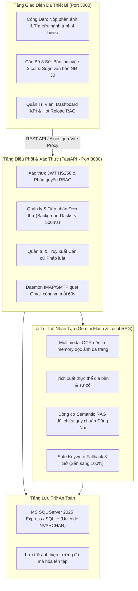

# CỔNG TIẾP NHẬN & PHÂN LUỒNG ĐƠN THƯ THÔNG MINH – TỈNH ĐỒNG NAI
> **Hệ Thống Dịch Vụ Công & Nền Tảng Điều Phối Đơn Thư Ứng Dụng Trí Tuệ Nhân Tạo (DongNai Civic Router)**  
> *Đơn vị ứng dụng đề xuất: Văn phòng UBND Tỉnh & Trung tâm Phục vụ Hành chính công Tỉnh Đồng Nai*

[](https://dichvucong.gov.vn)
[](https://fastapi.tiangolo.com)
[](https://react.dev)
[](https://ai.google.dev)
[](LICENSE)

---

## 📖 GIỚI THIỆU TỔNG QUAN

Hệ thống được thiết kế và phát triển bám sát tiêu chuẩn Cổng Dịch vụ công Quốc gia, nhằm giải quyết dứt điểm các điểm nghẽn lớn trong tiếp nhận, xử lý đơn thư phản ánh, kiến nghị của công dân và tổ chức trên địa bàn tỉnh Đồng Nai:
1. **Tiếp nhận đa kênh hợp nhất 24/7:** Nộp trực tuyến qua Cổng DVC, nhận dạng tệp ảnh hiện trường / trang đơn viết tay đa trang bằng AI Multimodal OCR, và tự động đồng bộ hòm thư điện tử công vụ qua giao thức IMAP SSL.
2. **Định tuyến tự động dưới 1 giây (Sub-second AI Triage):** Kết hợp mô hình Gemini Flash và kho tri thức pháp lý địa phương RAG, phân luồng chính xác trên 95% về đúng 8 Sở/Ngành chuyên trách.
3. **Cơ chế dự phòng Safe Keyword Fallback:** Duy trì tính sẵn sàng 100%, bảo đảm không bao giờ mất đơn của người dân ngay cả khi gián đoạn mạng quốc tế hoặc cạn hạn mức API.
4. **Bàn làm việc cán bộ chuẩn Nghị định 30/2020/NĐ-CP:** Bố cục 2 cột công thái học đối chiếu ảnh gốc/OCR, tự động trích dẫn điều khoản luật và tạo sẵn dự thảo công văn hành chính chuẩn thể thức.
5. **Minh bạch hóa & Giám sát số:** Cung cấp mã định danh chuẩn hóa `ĐN-YYYYMMDD-XXXX`, Thẻ AI Phân tích công khai và Bảng điều hành số (Dashboard) 6 chỉ số KPI cho lãnh đạo tỉnh.

---

## ⚡ KHỞI ĐỘNG NHANH HỆ THỐNG (QUICKSTART)

### Cách 1: Khởi động 1-chạm tự động bằng kịch bản Windows (Khuyên dùng)
Hệ thống đã tích hợp sẵn 2 script tự động hóa tại thư mục gốc:
- **Khởi động toàn bộ:** Nhấp đúp chuột vào file [run.bat](file:///d:/Code/DauTruongAI/run.bat) (hoặc gõ `.\run.bat` trong terminal). Hệ thống sẽ tự động khởi chạy đồng thời Backend FastAPI (cổng 8000) và Frontend Vite (cổng 3000) trong 2 cửa sổ độc lập.
- **Tắt sạch toàn bộ:** Nhấp đúp chuột vào file [stop.bat](file:///d:/Code/DauTruongAI/stop.bat) (hoặc gõ `.\stop.bat`) để giải phóng toàn bộ tiến trình ngầm, tránh xung đột cổng.

---

### Cách 2: Khởi động thủ công từng phân hệ

#### Bước 1: Khởi động Backend (FastAPI - Port 8000)
```powershell
# 1. Di chuyển vào thư mục backend
cd D:\Code\DauTruongAI\backend

# 2. Kích hoạt môi trường ảo (nếu có)
.\venv\Scripts\Activate.ps1

# 3. Cài đặt các gói phụ thuộc (chỉ cần chạy lần đầu)
pip install -r requirements.txt

# 4. Khởi chạy máy chủ API
python -m uvicorn main:app --reload --host 0.0.0.0 --port 8000
```
- **Máy chủ Backend API:** `http://localhost:8000`
- **Tài liệu Swagger UI:** `http://localhost:8000/docs`
- **Kiểm tra sức khỏe:** `http://localhost:8000/health`

#### Bước 2: Khởi động Frontend (React 18 + Vite - Port 3000)
Mở một cửa sổ dòng lệnh thứ hai:
```powershell
# 1. Di chuyển vào thư mục frontend
cd D:\Code\DauTruongAI\frontend

# 2. Cài đặt các gói npm (chỉ cần chạy lần đầu)
npm install

# 3. Khởi chạy giao diện phát triển
npm run dev
```
- **Cổng Dịch vụ công & Bàn làm việc:** `http://localhost:5173`

---

## 👥 DANH MỤC 10 TÀI KHOẢN KIỂM THỬ NGHIỆP VỤ (RBAC)

Hệ thống thiết lập cơ chế kiểm soát truy cập dựa trên vai trò nghiêm ngặt (Hierarchical Role-Based Access Control) với 10 tài khoản thử nghiệm tương ứng:

| STT | Phân hệ / Đối tượng | Tên đăng nhập | Mật khẩu | Quyền (Role) | Chức năng nghiệp vụ chính |
| :---: | :--- | :--- | :--- | :---: | :--- |
| **1** | **Quản trị viên Hệ thống** | `admin` | `admin123` | `ADMIN` | Bảng điều hành số KPI toàn tỉnh, duyệt tài khoản cán bộ mới, điều phối hàng đợi ngoại lệ, quản trị kho luật RAG & Hot Reload |
| **2** | **Công dân / Doanh nghiệp** | `congdan1` | `citizen123` | `CITIZEN` | Nộp đơn phản ánh (Web/Ảnh), nhận mã điện tử `ĐN`, xem Thẻ AI phân tích, tra cứu hành trình 4 bước, xem lịch sử đơn cá nhân |
| **3** | **Sở Giao thông Vận tải** | `canbo_gtvt` | `officer123` | `OFFICER` | Bàn làm việc cán bộ, thẩm định phản ánh hạ tầng đường bộ, cầu cống, đèn tín hiệu, điểm đen TNGT |
| **4** | **Sở Tài nguyên & Môi trường** | `canbo_tnmt` | `officer123` | `OFFICER` | Bàn làm việc cán bộ, thẩm định ô nhiễm nguồn nước KCN, bãi rác tự phát, tranh chấp quyền sử dụng đất |
| **5** | **Sở Xây dựng** | `canbo_xaydung` | `officer123` | `OFFICER` | Bàn làm việc cán bộ, thẩm định công trình xây dựng trái phép, nứt lún lân cận, vi phạm trật tự xây dựng |
| **6** | **Sở Y tế** | `canbo_yte` | `officer123` | `OFFICER` | Bàn làm việc cán bộ, thẩm định vệ sinh an toàn thực phẩm, ngộ độc thức ăn, sai phạm cơ sở y tế tư nhân |
| **7** | **Sở Giáo dục & Đào tạo** | `canbo_gddt` | `officer123` | `OFFICER` | Bàn làm việc cán bộ, thẩm định cơ sở vật chất trường học, lạm thu đầu năm, vi phạm đạo đức nhà giáo |
| **8** | **Sở Lao động - TB & XH** | `canbo_ldtbxh` | `officer123` | `OFFICER` | Bàn làm việc cán bộ, thẩm định tranh chấp quyền lợi công nhân KCN, nợ bảo hiểm xã hội, an sinh xã hội |
| **9** | **Công an Tỉnh Đồng Nai** | `canbo_congan` | `officer123` | `OFFICER` | Bàn làm việc cán bộ, thẩm định an ninh trật tự khu dân cư, trộm cắp, đua xe trái phép, lừa đảo công nghệ cao |
| **10**| **Bộ phận Một cửa / Huyện** | `canbo_motcua` | `officer123` | `OFFICER` | Bàn làm việc Một cửa, chuyển tuyến hồ sơ thủ tục hành chính cấp huyện/xã, chứng thực, hộ tịch |

---

## 🏛️ BẢN ĐỒ TÀI LIỆU DỰ ÁN

| Tài liệu | Đường dẫn liên kết | Mô tả nội dung |
| :--- | :--- | :--- |
| **Sổ tay Hướng dẫn Sử dụng** | [HUONG_DAN_SU_DUNG.md](file:///d:/Code/DauTruongAI/HUONG_DAN_SU_DUNG.md) | **Cẩm nang chi tiết từng bước** cho Công dân, 8 Cán bộ Sở và Quản trị viên kèm ảnh minh họa và hướng dẫn sự cố |
| **Bản Thuyết minh Sản phẩm** | [THUYET_MINH_SAN_PHAM.md](file:///d:/Code/DauTruongAI/THUYET_MINH_SAN_PHAM.md) | Thuyết minh giải pháp công nghệ, tính đột phá, hiệu quả kinh tế - xã hội và kiến trúc tổng thể phục vụ hội đồng chấm thi |
| **Báo cáo Kiểm thử Tự động E2E**| [QA_REPORT.md](file:///d:/Code/DauTruongAI/QA_REPORT.md) | Báo cáo kiểm định chất lượng chức năng và giao diện Responsive (Playwright tự động chụp màn hình, 100% đạt) |
| **Đặc tả Kiến trúc & CSDL** | [architecture.md](file:///d:/Code/DauTruongAI/docs/architecture.md) | Thiết kế lược đồ quan hệ CSDL MS SQL Server 2025 Express, lưu đồ dữ liệu đa kênh và luồng xử lý AI |
| **Quy chuẩn Kỹ thuật & Vận hành**| [rules.md](file:///d:/Code/DauTruongAI/docs/rules.md) | Bộ quy chuẩn lập trình Backend, Frontend, bảo mật thông tin và an toàn mã nguồn |
| **Tài liệu Backend** | [backend/README.md](file:///d:/Code/DauTruongAI/backend/README.md) | Hướng dẫn phát triển, cấu trúc module, danh mục API Endpoints và cơ chế RAG |
| **Tài liệu Frontend** | [frontend/README.md](file:///d:/Code/DauTruongAI/frontend/README.md) | Hướng dẫn giao diện React 18, kiến trúc tính năng, bảng màu GovTech UI và bảo vệ tuyến đường RBAC |

---

## 🏗️ KIẾN TRÚC CÔNG NGHỆ CỐT LÕI



---

## 🛠️ CÔNG NGHỆ SỬ DỤNG (TECH STACK)

- **Frontend:** React 18, Vite 6, Tailwind CSS v3, Lucide React Icons, Axios.
- **Backend:** Python 3.10–3.14, FastAPI 0.115+, Uvicorn, Pydantic v2, SQLAlchemy ORM 2.0.
- **Cơ sở dữ liệu:** Microsoft SQL Server 2025 Express (với kiểu dữ liệu `NVarCharMax` hỗ trợ tiếng Việt có dấu hoàn hảo) / SQLite 3 tự động phụ trợ.
- **Trí tuệ nhân tạo:** Google Gemini Flash Multimodal REST API kết hợp Động cơ RAG truy xuất kho tri thức văn bản quy phạm pháp luật tỉnh Đồng Nai.
- **Xử lý ảnh:** `Pillow` nén ảnh trong RAM (`compress_pil_in_memory`) tối ưu dung lượng dưới 1.5MB trước khi gọi AI.
- **Kiểm thử tự động:** Playwright Automation Test Suite kiểm thử trọn vẹn luồng E2E trên trình duyệt thật.

---

## 🔒 AN TOÀN VÀ BẢO MẬT THÔNG TIN

1. **Tuân thủ quy định bảo mật mã nguồn:** Không ghi cứng (hardcode) bất kỳ khóa bí mật API Key, mật khẩu CSDL trong mã nguồn Git; toàn bộ cấu hình nạp qua file biến môi trường `.env`.
2. **Kiểm soát truy cập phân tầng (RBAC):** Mã hóa JWT với thuật toán `HS256`, kiểm tra quyền chặt chẽ tại cả tầng Frontend Router và tầng Backend Dependency.
3. **Vết kiểm toán minh bạch (Audit Trail):** Mọi hành động chuyển tuyến hồ sơ (Reassign) hoặc thay đổi thẩm quyền đều được lưu vết đầy đủ vào trường `admin_note` gồm thời gian, người thực hiện và lý do điều chỉnh.

---

## 📞 LIÊN HỆ & BẢN QUYỀN
- **Đơn vị phát triển:** Dự án DongNai Civic Router – Đấu Trường AI 2026.
- **Phiên bản:** Release 2.1.0 (Enterprise Production Readiness).
- **Mã nguồn:** Bản quyền thuộc về tác giả & Ban Quản trị Dự án.
