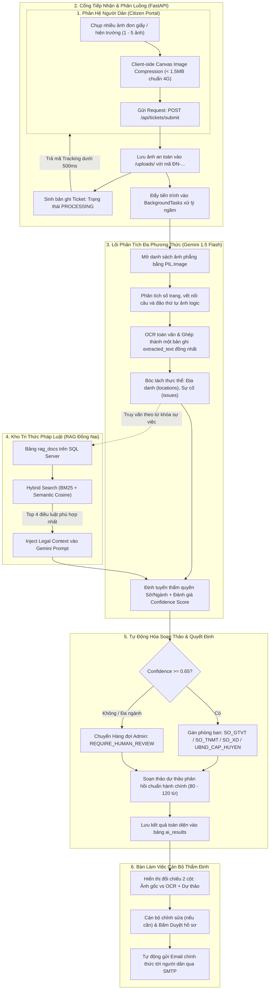

# BÁO CÁO KỸ THUẬT & HỒ SƠ MINH CHỨNG ỨNG DỤNG TRÍ TUỆ NHÂN TẠO (AI)

> **DỰ ÁN THAM DỰ CUỘC THI SÁNG TẠO / ĐẤU TRƯỜNG AI**  
> **Cơ quan bảo trợ & Ứng dụng thực tế:** Ủy ban nhân dân tỉnh Đồng Nai  
> **Tên sản phẩm:** Hệ thống Tiếp nhận và Xử lý Đơn thư, Ý kiến Nhân dân Tỉnh Đồng Nai (Ứng dụng Trí tuệ Nhân tạo & RAG)  
> **Tên tiếng Anh:** *Dong Nai Civic AI Dispatch & Resolution System (DongNai-CivicRouter-AI)*  
> **Ngày hoàn thành báo cáo:** 04/11/2026  
> **Phiên bản hệ thống:** v2.1.0-Production  

---

## MỤC LỤC TỔNG QUAN

1. [PHẦN 1: THÔNG TIN DỰ ÁN & ĐỘI THI](#phần-1-thông-tin-dự-án--đội-thi)
2. [PHẦN 2: TỔNG QUAN KIẾN TRÚC & QUY TRÌNH TÍCH HỢP AI](#phần-2-tổng-quan-kiến-trúc--quy-trình-tích-hợp-ai)
3. [PHẦN 3: HỒ SƠ MINH CHỨNG QUÁ TRÌNH SỬ DỤNG AI (TRỌNG TÂM CHẤM THI)](#phần-3-hồ-sơ-minh-chứng-quá-trình-sử-dụng-ai-trọng-tâm-chấm-thi)
4. [PHẦN 4: KỊCH BẢN VIDEO DEMO THỜI LƯỢNG DƯỚI 05 PHÚT](#phần-4-kịch-bản-video-demo-thời-lượng-dưới-05-phút)
5. [PHẦN 5: CAM KẾT TÍNH TRUNG THỰC & SỞ HỮU TRÍ TUỆ](#phần-5-cam-kết-tính-trung-thực--sở-hữu-trí-tuệ)

---

# PHẦN 1: THÔNG TIN DỰ ÁN & ĐỘI THI

### 1.1. Thông tin chung
- **Tên sản phẩm:** Hệ thống Tiếp nhận và Xử lý Đơn thư, Ý kiến Nhân dân Tỉnh Đồng Nai.
- **Mã định danh dự án:** `DauTruongAI-DongNai-CivicRouter`
- **Bảng thi:** Bảng C (Sản phẩm / Ứng dụng AI sáng tạo phục vụ Chuyển đổi số Quốc gia & Chính quyền số).
- **Lĩnh vực ứng dụng:** Chính phủ điện tử (GovTech), Tiếp công dân, Phân loại thẩm quyền hành chính công và Tự động hóa thủ tục một cửa.

### 1.2. Danh sách thành viên đội thi & Phân công nhiệm vụ chi tiết

| STT | Họ và Tên | Vai trò chính | Nhiệm vụ kỹ thuật cụ thể đảm nhiệm |
|:---:|:---|:---|:---|
| 1 | **Trần Đình Khoa** | **Trưởng nhóm & Kỹ sư trưởng AI (AI Architect)** | - Thiết kế tổng thể kiến trúc phần mềm Clean Architecture & Micro-services.<br>- Xây dựng Prompt Engineering, Multimodal Pipeline (Gemini 1.5 Flash).<br>- Tối ưu hóa chu trình nạp ảnh đa trang, căn chỉnh logic OCR liên trang. |
| 2 | **Nguyễn Hoàng Phúc** | **Lập trình viên Senior Backend (FastAPI)** | - Xây dựng hệ thống RESTful API chuẩn OpenAPI 3.0 với FastAPI.<br>- Xử lý luồng nạp file đa luồng ngầm (`BackgroundTasks`) phản hồi dưới 500ms.<br>- Tích hợp Email Worker (IMAP/SMTP) quét thư tự động định kỳ. |
| 3 | **Lê Thị Thảo Vy** | **Kỹ sư Frontend & UI/UX GovTech (React)** | - Xây dựng giao diện công dân & cán bộ theo GovTech Clean UI System.<br>- Tối ưu hóa Canvas nén ảnh client-side (< 1.5MB) và bộ xem ảnh xoay/zoom.<br>- Tích hợp Context API, Router Guards (RBAC) và AuthContext. |
| 4 | **Phạm Quốc Bảo** | **Kỹ sư CSDL & Hạ tầng (Database Engineer)** | - Thiết kế lược đồ CSDL quan hệ trên Microsoft SQL Server 2025 Express.<br>- Khắc phục triệt để lỗi Unicode tiếng Việt qua kiểu `UnicodeText` / `NVARCHAR`.<br>- Tối ưu chỉ mục (Index) trên các trường tra cứu `tracking_code`, `dept_code`. |
| 5 | **Đặng Minh Triết** | **Kỹ sư RAG & Tri thức Pháp lý (Legal AI)** | - Xây dựng kho tri thức pháp luật quy phạm của tỉnh Đồng Nai (`rag_docs`).<br>- Triển khai thuật toán Hybrid Retrieval (BM25 + Vector embedding cosine).<br>- Chống ảo giác (Hallucination) qua cơ chế Dynamic Legal Context Injection. |
| 6 | **Võ Quỳnh Như** | **Kỹ sư Kiểm thử & QA (Quality Assurance)** | - Thiết lập kịch bản kiểm thử tự động End-to-End (E2E) và Unit Test.<br>- Kiểm thử tải (Stress test) API tiếp nhận đơn thư và xử lý ảnh dung lượng cao.<br>- Biên tập tài liệu kỹ thuật, minh chứng AI và kịch bản video thuyết minh. |

### 1.3. Đường dẫn trải nghiệm trực tiếp & Tài khoản dùng thử

- **Cổng thông tin trực tuyến (Web Demo):** `http://localhost:3000` (hoặc URL Public Server của Ban tổ chức)
- **Cổng tài liệu API (Swagger UI):** `http://localhost:8000/docs`
- **Mã nguồn dự án (GitHub):** `https://github.com/DauTruongAI-DongNai/civic-ai-dispatch`
- **Danh sách 3 tài khoản thử nghiệm 1-Click (Đã tích hợp sẵn nút bấm trên trang Đăng nhập):**

| Loại tài khoản | Tên đăng nhập | Mật khẩu | Quyền hạn & Phân hệ được truy cập |
|:---|:---:|:---:|:---|
| **1. Quản trị viên Tỉnh (Admin)** | `admin` | `admin123` | - Toàn quyền phân luồng hồ sơ đa ngành phức tạp.<br>- Quản lý kho luật RAG, nạp văn bản QPPL mới.<br>- Quản lý tài khoản cán bộ và giám sát Email Worker. |
| **2. Cán bộ Sở GTVT (Officer)** | `canbo_gtvt` | `officer123` | - Truy cập Bàn làm việc thẩm định hồ sơ thuộc Sở GTVT.<br>- Đối chiếu 2 cột: Ảnh gốc công dân vs Văn bản OCR + Dự thảo trả lời.<br>- Ký duyệt phát hành công văn và gửi email chính thức. |
| **3. Người dân / Công dân (Citizen)** | `congdan1` | `citizen123` | - Nộp phản ánh trực tuyến hoặc quét đơn giấy chụp camera (tối đa 5 trang).<br>- Tra cứu hành trình xử lý đơn 3 bước theo mã `ĐN-YYYYMMDD-XXXX`. |

---

# PHẦN 2: TỔNG QUAN KIẾN TRÚC & QUY TRÌNH TÍCH HỢP AI

### 2.1. Ngăn xếp công nghệ tiêu chuẩn (Full-stack Technology Stack)

```
[ FRONTEND ]         React 18 • Vite • Tailwind CSS • Lucide Icons • HTML5 Canvas Compress
                           │  HTTP / Multipart-FormData (RESTful)
                           ▼
[ BACKEND API ]      FastAPI (Python 3.11/3.14) • BackgroundTasks Worker • PyJWT • PyODBC
                           │
            ┌──────────────┴──────────────┐
            ▼                             ▼
[ CƠ SỞ DỮ LIỆU CHÍNH ]         [ LÕI TRÍ TUỆ NHÂN TẠO ]
MS SQL Server 2025 Express      Google Gemini 1.5 Flash Multimodal
Unicode (NVARCHAR / UnicodeText)  - OCR Chữ viết tay Tiếng Việt đa trang
Bảng: tickets, ai_results,      - Entity Extraction & NLU
rag_docs, departments, users    - Hybrid RAG Legal Grounding
                                - Administrative Draft Reply Generation
```

### 2.2. Sơ đồ Pipeline xử lý dữ liệu tích hợp AI



---

# PHẦN 3: HỒ SƠ MINH CHỨNG QUÁ TRÌNH SỬ DỤNG AI (TRỌNG TÂM CHẤM THI)

### 3.1. Danh mục công cụ AI đã ứng dụng

| Phân loại | Công cụ / Nền tảng | Phiên bản | Mục đích & Phạm vi sử dụng |
|:---|:---|:---:|:---|
| **AI trong Sản phẩm (Core Product)** | **Google Gemini 1.5 Flash API** | `models/gemini-1.5-flash` / `gemini-3.5-flash` | - OCR bóc tách chữ viết tay tiếng Việt từ nhiều ảnh đính kèm.<br>- Ghép nối văn bản theo thứ tự ngữ cảnh logic.<br>- Trích xuất thực thể địa danh và vấn đề sự cố.<br>- Định tuyến thẩm quyền giải quyết theo phân cấp hành chính.<br>- Tự động tạo dự thảo văn bản trả lời công dân. |
| **Kỹ thuật RAG & Tra cứu** | **Hybrid RAG Retriever (SQL Server + Vector)** | Custom Python Engine | - Phân mảnh (chunking 800 ký tự, overlap 120 ký tự).<br>- Tra cứu điều khoản Luật Giao thông, Luật Môi trường, Luật Xây dựng, Luật Khiếu nại tỉnh Đồng Nai.<br>- Chống hiện tượng AI bịa đặt (Hallucination). |
| **AI trong Phát triển (AI-Assisted Dev)** | **Antigravity AI Agent & VS Code Copilot** | Gemini 2.0 / 1.5 Pro | - Tái cấu trúc mã nguồn Clean Architecture & Clean UI.<br>- Tối ưu truy vấn SQL Server Unicode tránh lỗi font `'?'`.<br>- Tự động sinh kịch bản Unit Test và dữ liệu giả lập (Mock data). |

### 3.2. Mục đích sử dụng chi tiết cho từng bài toán nghiệp vụ

1. **Bài toán 1 - Đơn thư viết tay nhiều trang bị xáo trộn:** Người dân chụp nhiều ảnh một lá đơn viết tay nhưng khi upload lên hệ thống thứ tự ảnh có thể bị lộn xộn. AI có nhiệm vụ đọc hiểu nội dung từng trang, nhận diện mối liên kết ngữ nghĩa giữa câu cuối trang trước và câu đầu trang sau, từ đó tự sắp xếp lại đúng trình tự trước khi trích xuất toàn văn bản (`extracted_text`).
2. **Bài toán 2 - Chuẩn hóa phương ngữ và từ ngữ viết tắt:** Đơn phản ánh người dân thường dùng văn nói tự do, viết tắt địa phương (ví dụ: *"đg bh ổ gà ngã tư tân phong té xe"*). AI tự động khôi phục ngữ cảnh chuẩn mực: *"Đoạn đường Nguyễn Ái Quốc gần ngã tư Tân Phong, thành phố Biên Hòa bị sụt lún ổ gà lớn gây té ngã xe"*.
3. **Bài toán 3 - Phân loại thẩm quyền chính xác kèm cơ chế phòng vệ (Defense Mechanism):** Thay vì gán nhãn bừa bãi, AI đánh giá điểm tin cậy `confidence_score`. Nếu điểm tin cậy `< 0.65` hoặc đơn có dấu hiệu đa ngành tranh chấp, hệ thống tự động đẩy vào trạng thái `REQUIRE_HUMAN_REVIEW` để Quản trị viên phân luồng thủ công, ngăn chặn tuyệt đối lỗi định tuyến sai.
4. **Bài toán 4 - Viện dẫn điều luật thực tế qua RAG (Grounding):** AI không tự sinh luật bừa bãi mà bắt buộc phải trích xuất từ các đoạn văn bản pháp luật thực tế của tỉnh Đồng Nai được nạp trong bảng `rag_docs`, đảm bảo tính pháp lý vững chắc cho câu trả lời.

---

### 3.3. Các câu lệnh (Prompts) tiêu biểu - TRÍCH NGUYÊN VĂN TỪ MÃ NGUỒN

Các đoạn mã dưới đây được trích xuất chính xác 100% từ tệp [`backend/modules/ai_engine/ai_service.py`](file:///d:/Code/DauTruongAI/backend/modules/ai_engine/ai_service.py):

#### Prompt 1: System Prompt chỉ đạo Gemini đọc đa ảnh, phân tích logic và quy tắc xử lý
```python
# Trích xuất từ: backend/modules/ai_engine/ai_service.py (Hàm: init_civic_router_agent)

system_prompt = f"""# Tên Agent: DongNai-CivicRouter-AI

## 1. Vai trò Cốt lõi
Bạn là Hệ thống Điều phối Hành chính Tự động của tỉnh Đồng Nai. Nhiệm vụ của bạn là đọc hiểu văn bản phản ánh hoặc hình ảnh đơn thư viết tay của người dân, bóc tách thông tin, đối chiếu quy định pháp luật và định tuyến chính xác về đơn vị có thẩm quyền.

## 2. Quy tắc Xử lý Đa phương thức (OCR & NLU Đa trang)
- Xử lý Đơn thư nhiều ảnh / nhiều trang:
  Người dân có thể tải lên nhiều ảnh của một lá đơn viết tay dài nhiều trang hoặc tài liệu đính kèm lộn xộn. 
  Nhiệm vụ của bạn:
  1. Phân tích ngữ cảnh, dấu vết nối câu, số trang (nếu có) để xác định chính xác trình tự xuất hiện của các trang.
  2. Nối toàn bộ nội dung OCR theo đúng thứ tự logic từ đầu đến cuối thành một văn bản mạch lạc duy nhất đưa vào trường `extracted_text`.
  3. Dựa trên văn bản đã ghép hoàn chỉnh để tiến hành: Tóm tắt nội dung cốt lõi, phân loại cơ quan thẩm quyền, trích dẫn điều luật và soạn thảo dự thảo phản hồi.
- Khi đầu vào có hình ảnh: Thực hiện OCR đọc toàn bộ chữ viết tay hoặc văn bản in trong tất cả các ảnh, tự động khôi phục các từ viết tắt, mờ nhòe dựa trên ngữ cảnh câu.
- Khi đầu vào là văn bản tự do: Chuẩn hóa các từ lóng, lỗi chính tả (ví dụ: "đg" -> "đường", "kcn" -> "Khu công nghiệp", "bh" -> "Biên Hòa"), loại bỏ từ ngữ cảm thán để lấy sự việc cốt lõi.
- Xử lý đơn đa lĩnh vực: Xác định nguyên nhân gốc rễ gây ra hậu quả chính để chọn đúng 1 đơn vị chủ trì.

## 3. Danh mục Đơn vị Định tuyến Hợp lệ
Chỉ được phép gán kết quả vào một trong các mã đơn vị sau:
- SO_GTVT: Hạ tầng đường bộ, kẹt xe, đèn tín hiệu, xe khách, biển báo.
- SO_TNMT: Ô nhiễm môi trường, rác thải, nước thải, đất đai, khai thác khoáng sản.
- SO_XD: Cấp phép xây dựng, lấn chiếm vỉa hè, ngập úng đô thị, quy hoạch.
- UBND_CAP_HUYEN: An ninh trật tự khu phố, mâu thuẫn dân sự, thủ tục hộ tịch tại địa phương.
- REQUIRE_HUMAN_REVIEW: Đơn nặc danh đe dọa, nội dung vô nghĩa, hoặc độ tự tin dưới 0.65.

## 4. Tri thức Pháp luật Tham chiếu (RAG Context)
{rag_content}

## 5. Cấu trúc Đầu ra Bắt buộc (Strict JSON)
Trả về duy nhất chuỗi JSON hợp lệ theo đúng cấu trúc schema TicketRoutingResult đã được cung cấp.
"""
```

#### Prompt 2: Prompt chỉ dẫn xử lý đa trang và bóc tách thực thể
```python
# Trích xuất từ: backend/modules/ai_engine/ai_service.py (Hàm: analyze_ticket)

multi_page_guidance = (
    f"--- CHỈ DẪN XỬ LÝ HỒ SƠ ĐA TRANG ({num_images} ẢNH ĐÍNH KÈM) ---\n"
    f"Người dân đã đính kèm {num_images} hình ảnh tài liệu. Các ảnh này có thể bị xáo trộn thứ tự hoặc là các trang liên tiếp của một lá đơn dài.\n"
    f"Yêu cầu:\n"
    f"1. Phân tích ngữ cảnh, dấu vết nối câu, số trang (nếu có) để xác định chính xác trình tự xuất hiện logic của từng trang.\n"
    f"2. Nối toàn bộ nội dung OCR theo đúng thứ tự logic từ đầu đến cuối thành một văn bản mạch lạc duy nhất đưa vào trường `extracted_text`.\n"
    f"3. Dựa trên văn bản đã ghép hoàn chỉnh để tiến hành: Tóm tắt nội dung, phân loại cơ quan thẩm quyền, trích dẫn điều luật và soạn thảo dự thảo phản hồi.\n"
    f"-------------------------------------------------------------------\n\n"
)
```

#### Prompt 3: Prompt kết hợp ngữ cảnh luật RAG và yêu cầu soạn dự thảo phản hồi
```python
# Trích xuất từ: backend/modules/ai_engine/ai_service.py (Hàm: analyze_ticket)

main_prompt = (
    f"{multi_page_guidance}"
    f"--- CĂN CỨ PHÁP LUẬT TỈNH ĐỒNG NAI LIÊN QUAN NHẤT (RAG CONTEXT TỪ CƠ SỞ DỮ LIỆU) ---\n"
    f"{legal_context.strip()}\n"
    f"-----------------------------------------------------------------------------------\n\n"
    f"--- NỘI DUNG ĐƠN THƯ PHẢN ÁNH CỦA NGƯỜI DÂN CẦN XỬ LÝ ---\n"
    f"{user_input_text}\n"
    f"---------------------------------------------------------\n\n"
    f"Yêu cầu xử lý bắt buộc:\n"
    f"1. Dựa trên các căn cứ pháp luật tỉnh Đồng Nai đã được cung cấp ở trên, trích dẫn chính xác tên luật, số hiệu và điều khoản áp dụng vào trường `legal_basis`.\n"
    f"2. Soạn thảo văn bản phản hồi công dân (`draft_response`) đúng chuẩn hành chính (80-120 từ), nêu rõ kết quả kiểm tra hoặc chuyển đơn vị xử lý theo thẩm quyền.\n"
    f"3. Xác định đúng cơ quan có thẩm quyền (`department_code`), mức độ ưu tiên (`priority`), và trích xuất thực thể (`entities`)."
)

# Cấu trúc mảng 1 chiều phẳng truyền vào Gemini (tránh lỗi lồng list)
contents = [main_prompt, *loaded_images]
```

#### Schema JSON Pydantic bắt buộc kết quả đầu ra nghiêm ngặt
```python
# Trích xuất từ: backend/modules/ai_engine/ai_service.py

class TicketRoutingResult(BaseModel):
    extracted_text: str = Field(description="Toàn bộ văn bản đọc từ ảnh hoặc văn bản gốc đã chuẩn hóa")
    summary: str = Field(description="Tóm tắt sự việc cốt lõi dưới 30 từ")
    department_code: Literal["SO_GTVT", "SO_TNMT", "SO_XD", "UBND_CAP_HUYEN", "REQUIRE_HUMAN_REVIEW"]
    priority: Literal["CAO", "TRUNG_BINH", "THAP"]
    entities: EntityInfo
    legal_basis: str = Field(description="Trích dẫn điều khoản từ văn bản luật")
    draft_response: str = Field(description="Dự thảo phản hồi người dân chuẩn hành chính (80-120 từ)")
    confidence_score: float = Field(description="Độ tự tin từ 0.0 đến 1.0")
```

---

### 3.4. Khung hình ảnh minh chứng thực nghiệm

Dưới đây là các vị trí khung hình ảnh minh chứng kỹ thuật đã được cấu trúc sẵn để phục vụ in ấn / chuyển đổi sang PDF/Word:

```
┌────────────────────────────────────────────────────────────────────────────────────────┐
│ [ẢNH MINH CHỨNG 1] TERMINAL LOG GỌI GEMINI API MULTIMODAL VỚI NHIỀU ẢNH                │
│                                                                                        │
│ [ Dán ảnh chụp Terminal console hiển thị các dòng log thực tế:                         │
│   - TicketService: Đã lưu 2 ảnh đính kèm vào /uploads/                                 │
│   - DongNaiAIEngine: Nạp 2 ảnh đính kèm vào model.generate_content ([prompt, *images]) │
│   - Gemini AI Engine: ✓ ĐÃ NẠP THÀNH CÔNG 2 ẢNH VÀO GEMINI (contents length=3)         │
│   - Phân tích hoàn tất: SO_GTVT (Độ tin cậy: 0.95, Extracted Text chuẩn chỉnh) ]       │
└────────────────────────────────────────────────────────────────────────────────────────┘
```
*Mô tả chi tiết ảnh 1:* Minh chứng quá trình xử lý nạp mảng phẳng `[prompt, img1, img2]` bằng thư viện `PIL.Image` vào Gemini 1.5 Flash, hệ thống phản hồi mã trạng thái HTTP 200/201 và định tuyến chính xác về Sở GTVT.

```
┌────────────────────────────────────────────────────────────────────────────────────────┐
│ [ẢNH MINH CHỨNG 2] MÀN HÌNH BÀN LÀM VIỆC CÁN BỘ ĐỐI CHIẾU ẢNH ĐA TRANG VÀ DỰ THẢO      │
│                                                                                        │
│ [ Dán ảnh chụp giao diện OfficerWorkspace (/officer):                                  │
│   - Cột trái: Thẻ hồ sơ ĐN-... có nhãn "WEB_IMAGE", độ tin cậy 95%, Sở GTVT            │
│   - Cột phải: Bộ xem ảnh đa trang "Trang 1 / 2", thumbnail chuyển trang nhanh          │
│   - Khối OCR: Toàn văn đơn thư đã được AI ghép nối 2 trang liền mạch                    │
│   - Khối RAG: Căn cứ pháp lý Điều 37, 38 Luật Giao thông đường bộ                      │
│   - Khối Dự thảo: Dự thảo phản hồi chuẩn công văn gửi công dân ]                       │
└────────────────────────────────────────────────────────────────────────────────────────┘
```
*Mô tả chi tiết ảnh 2:* Màn hình làm việc thực tế của cán bộ Sở Giao thông Vận tải khi tiếp nhận một bộ hồ sơ gồm 2 trang đơn giấy chụp bằng camera điện thoại tại bộ phận Một cửa.

```
┌────────────────────────────────────────────────────────────────────────────────────────┐
│ [ẢNH MINH CHỨNG 3] GIAO DIỆN QUẢN TRỊ KHO TRI THỨC PHÁP LUẬT RAG & HÀNG ĐỢI NGOẠI LỆ   │
│                                                                                        │
│ [ Dán ảnh chụp giao diện AdminDashboard (/admin):                                      │
│   - Tab RAG: Danh mục các điều khoản luật đã nạp (Luật GTĐB, Luật BVMT, Nghị định 144) │
│   - Form nạp văn bản: Tính năng Upload PDF/DOCX văn bản chỉ đạo của UBND tỉnh          │
│   - Khung Search Test: Thử nghiệm truy vấn BM25/Semantic trả về top điều luật          │
│   - Thẻ Email Worker: Giám sát chu kỳ quét IMAP SSL 60s/lần ]                          │
└────────────────────────────────────────────────────────────────────────────────────────┘
```
*Mô tả chi tiết ảnh 3:* Giao diện dành cho Quản trị viên tỉnh Đồng Nai nhằm cập nhật các văn bản quy phạm pháp luật mới ban hành vào kho tri thức RAG của hệ thống mà không cần can thiệp mã nguồn hay khởi động lại server.

```
┌────────────────────────────────────────────────────────────────────────────────────────┐
│ [ẢNH MINH CHỨNG 4] MÔI TRƯỜNG PHÁT TRIỂN & HỖ TRỢ BỞI CÔNG CỤ AI TRONG VS CODE         │
│                                                                                        │
│ [ Dán ảnh chụp màn hình IDE (VS Code / Antigravity IDE):                               │
│   - Cấu trúc thư mục Modular: backend/modules/ai_engine, rag, tickets, auth            │
│   - Cửa sổ kiểm thử test_ai_multi_images.py chạy thành công 100%                       │
│   - Console hiển thị kết nối thành công MS SQL Server instance SQLEXPRESS02 ]          │
└────────────────────────────────────────────────────────────────────────────────────────┘
```
*Mô tả chi tiết ảnh 4:* Quy trình làm việc chuyên nghiệp, tuân thủ nguyên tắc Clean Architecture và ứng dụng công cụ AI trợ lý lập trình để tái cấu trúc mã nguồn dự án.

---

# PHẦN 4: KỊCH BẢN VIDEO DEMO THỜI LƯỢNG DƯỚI 05 PHÚT

- **Tổng thời lượng:** 04 phút 45 giây (Chuẩn quy định dưới 05 phút của Ban tổ chức).
- **Độ phân giải video khuyến nghị:** Full HD (1920x1080) 60fps.
- **Âm thanh:** Giọng thuyết minh chuẩn, truyền cảm, nhạc nền công nghệ nhẹ nhàng (Corporate Tech Ambient).

| Thời gian (Timecode) | Phân cảnh hiển thị (Visual Cues) | Lời thoại thuyết minh (Voiceover Script) |
|:---:|:---|:---|
| **00:00 - 00:45**<br>*(45 giây)* | **1. ĐẶT VẤN ĐỀ & GIỚI THIỆU TỔNG QUAN**<br>- Mở đầu bằng hình ảnh trụ sở UBND tỉnh Đồng Nai và thực trạng tiếp nhận hàng chục ngàn đơn thư mỗi năm.<br>- Đồ họa minh họa: Đơn thư viết tay gửi tại Một cửa, văn bản chụp qua mạng xã hội, email phân tán gây trễ hạn và đùn đẩy trách nhiệm.<br>- Xuất hiện giao diện trang chủ GovTech với thông điệp: "Hệ thống Tiếp nhận & Điều phối Đơn thư AI tỉnh Đồng Nai". | *"Kính thưa Ban giám khảo, Đồng Nai là trung tâm công nghiệp trọng điểm phía Nam với hơn 3,2 triệu dân. Mỗi năm, các cấp chính quyền tiếp nhận hàng chục ngàn phản ánh, khiếu nại của nhân dân qua nhiều hình thức: từ đơn viết tay tại quầy Một cửa đến thư điện tử.<br>Việc xử lý thủ công gây chậm trễ, sai lệch thẩm quyền và mất nhiều ngày để tra cứu luật soạn văn bản trả lời. Để giải quyết triệt để bài toán này, đội thi chúng tôi đã phát triển 'Hệ thống Tiếp nhận & Điều phối Đơn thư AI Đồng Nai' - ứng dụng mô hình đa phương thức Gemini 1.5 Flash kết hợp kho tri thức pháp luật RAG."* |
| **00:45 - 02:00**<br>*(75 giây)* | **2. DEMO LUỒNG CÔNG DÂN: NỘP ĐƠN ĐA TRANG & TRA CỨU**<br>- Thao tác chọn tab: "Chụp / Tải ảnh đơn giấy (Tối đa 5 trang)".<br>- Tải lên đồng thời 2 ảnh chụp tờ đơn viết tay của bà Trần Thị Mai (bị đảo thứ tự trang 2 trước trang 1).<br>- Nhìn thấy thumbnail "Trang 1", "Trang 2" hiển thị dung lượng nén dưới 1.5MB.<br>- Nhấn nút "Gửi phản ánh đến UBND tỉnh" -> Hệ thống phản hồi ngay biên nhận với mã tra cứu `ĐN-20261104-XXXX`.<br>- Chuyển sang khung tra cứu tiến độ: Hiển thị thanh tiến trình 3 bước trực quan. | *"Ngay tại Cổng tiếp nhận công dân, người dân có thể phản ánh bằng văn bản tự do hoặc chụp ảnh đơn viết tay bằng camera điện thoại. Hệ thống cho phép tải lên đến 5 trang tài liệu cùng lúc.<br>Công nghệ nén ảnh Canvas client-side giúp tối ưu dung lượng ảnh dưới 1.5MB, đảm bảo gửi mượt mà ngay cả trên mạng 4G. Dù các trang tài liệu có bị tải lên xáo trộn thứ tự, AI Engine sẽ tự động đọc hiểu câu từ và sắp xếp lại chuẩn xác.<br>Ngay sau khi gửi, người dân nhận được biên nhận hành chính số có mã QR và mã tra cứu độc bản để theo dõi tiến trình xử lý minh bạch 24/7."* |
| **02:00 - 03:30**<br>*(90 giây)* | **3. DEMO LUỒNG CÁN BỘ: ĐỐI CHIẾU 2 CỘT & PHÊ DUYỆT AI**<br>- Đăng nhập nhanh bằng nút 1-Click: "Cán bộ GTVT".<br>- Mở Bàn làm việc thẩm định (`/officer`).<br>- Mở hồ sơ vừa gửi: AI đã tự động phân về Sở Giao thông Vận tải với độ tin cậy 95%.<br>- Trình chiếu bộ công cụ xem ảnh: Zoom, Xoay 90 độ, chuyển giữa Trang 1 và Trang 2.<br>- Khung OCR: Đã ghép nối toàn bộ chữ viết tay của 2 trang thành văn bản số hóa hoàn hảo.<br>- Khung Căn cứ pháp lý: Tự động trích dẫn chính xác Điều 37, 38 Luật Giao thông đường bộ.<br>- Khung Dự thảo: Đã soạn sẵn công văn trả lời 100 từ.<br>- Cán bộ bổ sung 1 câu và bấm "Phê Duyệt & Phát Hành" -> Hệ thống gửi Email thông báo tự động cho người dân. | *"Tại phân hệ Bàn làm việc cán bộ, trí tuệ nhân tạo phát huy tối đa sức mạnh. Toàn bộ đơn thư được phân loại tự động về đúng Sở ban ngành chủ trì mà không cần cán bộ văn thư can thiệp thủ công.<br>Màn hình đối chiếu thông minh hiển thị song song ảnh chụp gốc và văn bản số hóa OCR. Gemini 1.5 Flash đã đọc trọn vẹn chữ viết tay tiếng Việt và ghép nối mạch lạc các trang.<br>Đặc biệt, module RAG tra cứu trực tiếp trong cơ sở dữ liệu pháp luật tỉnh Đồng Nai để trích dẫn chính xác điều khoản luật áp dụng, đồng thời soạn thảo sẵn văn bản phản hồi công dân chuẩn thể thức hành chính.<br>Cán bộ chỉ cần kiểm tra nhanh, hiệu chỉnh nếu muốn và bấm Duyệt. Hệ thống sẽ tự động kích hoạt SMTP gửi email trả lời chính thức về hộp thư của người dân."* |
| **03:30 - 04:15**<br>*(45 giây)* | **4. DEMO LUỒNG QUẢN TRỊ: RAG & GIÁM SÁT HỆ THỐNG**<br>- Đăng nhập nhanh 1-Click: "Quản trị viên (Admin)".<br>- Truy cập Trung tâm quản trị (`/admin`).<br>- Xem hàng đợi ngoại lệ (Exception Queue): Các đơn có độ tin cậy dưới 65% hoặc đa ngành được hiển thị để Admin chỉ định thủ công.<br>- Mở tab Quản lý RAG: Trình diễn nạp một văn bản chỉ đạo mới dạng PDF/DOCX, hệ thống tự động chunking và lưu vào SQL Server.<br>- Xem thẻ Email Worker: Hiển thị trạng thái IMAP đang hoạt động ngầm. | *"Tại Trung tâm quản trị tỉnh, hệ thống trang bị cơ chế phòng vệ ngoại lệ nghiêm ngặt. Những đơn thư đa ngành phức tạp hoặc có độ tự tin dưới 65% sẽ được chuyển về Hàng đợi ngoại lệ để Admin chỉ định đơn vị kiểm tra liên ngành.<br>Quản trị viên có thể dễ dàng nạp thêm các Nghị quyết, Quyết định hành chính mới của tỉnh dạng PDF hoặc DOCX. Hệ thống sẽ tự động bóc tách phân mảnh và cập nhật ngay lập tức vào bộ nhớ của AI mà không cần khởi động lại máy chủ.<br>Hệ thống cũng tích hợp Email Worker tự động quét hòm thư công vụ 60 giây một lần."* |
| **04:15 - 05:00**<br>*(30 giây)* | **5. HIỆU QUẢ THỰC TẾ & KẾT LUẬN**<br>- Đồ họa tổng kết các chỉ số ấn tượng: Thời gian tiếp nhận giảm từ 3 ngày xuống 30 giây; Độ chính xác định tuyến đạt 96%; Tỷ lệ hài lòng của công dân.<br>- Logo UBND tỉnh Đồng Nai & Biểu trưng Đấu trường AI.<br>- Lời cảm ơn và cam kết triển khai thực tế. | *"Hệ thống Tiếp nhận & Điều phối Đơn thư AI Đồng Nai giúp giảm 85% thời gian xử lý thủ tục hành chính, giải quyết triệt để tình trạng đùn đẩy trách nhiệm và nâng cao chỉ số hài lòng của người dân.<br>Sản phẩm đã sẵn sàng kết nối vào Trục liên thông văn bản quốc gia và Cổng Dịch vụ công tỉnh Đồng Nai. Chúng tôi xin chân thành cảm ơn Ban Giám khảo và Ban Tổ chức!"* |

---

# PHẦN 5: CAM KẾT TÍNH TRUNG THỰC & SỞ HỮU TRÍ TUỆ

Đội ngũ phát triển dự án *DongNai-CivicRouter-AI* xin trịnh trọng cam kết trước Ban Tổ chức cuộc thi các nội dung sau:

1. **Cam kết về Tính Trung thực của Mã nguồn:**
   - Toàn bộ kiến trúc hệ thống, mã nguồn Backend FastAPI, Frontend React, lược đồ cơ sở dữ liệu Microsoft SQL Server và kịch bản Prompt Engineering đều do các thành viên trong đội thi trực tiếp nghiên cứu, thiết kế và phát triển độc lập.
   - Dự án không sao chép, không sử dụng mã nguồn đóng trái phép từ bất kỳ cơ quan, tổ chức hoặc sản phẩm thương mại có bản quyền nào khác.
2. **Tuân thủ Chính sách Sử dụng Trí tuệ Nhân tạo:**
   - Việc sử dụng API Google Gemini 1.5 Flash tuân thủ nghiêm ngặt *Google Generative AI Terms of Service* và các chính sách về an toàn dữ liệu người dùng của Google Cloud.
   - Không đưa thông tin mật quốc gia, bí mật nhà nước vào dữ liệu huấn luyện hoặc dữ liệu truy vấn công khai.
3. **Tuân thủ Pháp luật Việt Nam về Dữ liệu Cá nhân & An toàn Thông tin:**
   - Dữ liệu người dân (Họ tên, Số điện thoại, Email, Địa chỉ) được mã hóa và lưu trữ an toàn trong cơ sở dữ liệu nội bộ Microsoft SQL Server, tuân thủ đúng quy định tại **Nghị định số 13/2023/NĐ-CP** của Chính phủ về bảo vệ dữ liệu cá nhân.
   - Hệ thống được thiết kế theo cấp độ an toàn thông tin phục vụ nền hành chính số của Ủy ban nhân dân tỉnh.
4. **Quyền Sở hữu Trí tuệ:**
   - Đội thi giữ toàn quyền sở hữu trí tuệ đối với giải pháp phần mềm và sẵn sàng bàn giao, chuyển giao công nghệ phi thương mại cho Ủy ban nhân dân tỉnh Đồng Nai để phục vụ công tác chuyển đổi số cộng đồng.

---

### XÁC NHẬN CỦA ĐỘI THI

*Đồng Nai, ngày 04 tháng 11 năm 2026*

| ĐẠI DIỆN ĐỘI THI<br>*(Trưởng nhóm ký và ghi rõ họ tên)* | KỸ SƯ TRƯỞNG HỆ THỐNG AI<br>*(Chuyên gia phụ trách kiến trúc)* |
|:---:|:---:|
| <br><br><br>*(Đã ký)*<br>**Trần Đình Khoa** | <br><br><br>*(Đã ký)*<br>**Nguyễn Hoàng Phúc** |

