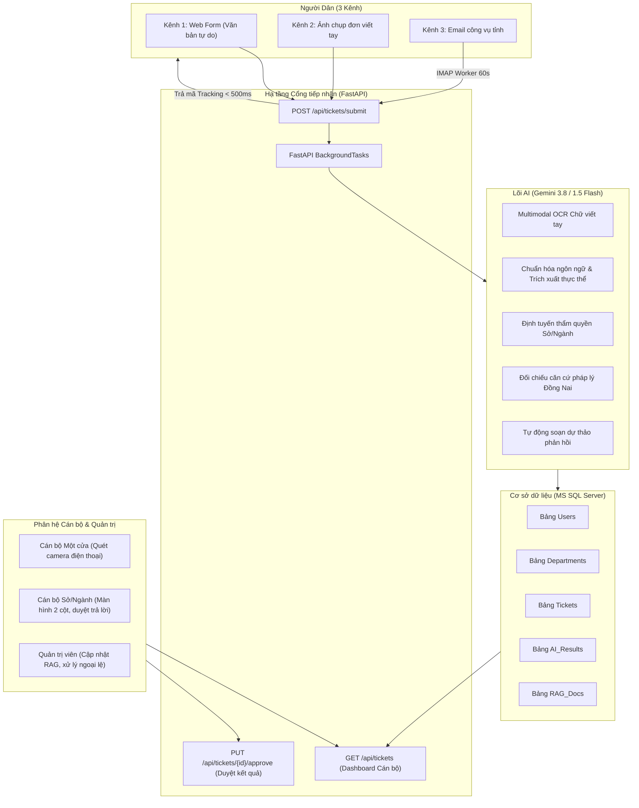

# KIẾN TRÚC HỆ THỐNG ĐIỀU PHỐI ĐƠN THƯ AI - TỈNH ĐỒNG NAI

## 1. Sơ đồ Tổng thể Hệ thống



---

## 2. Thiết kế Cơ sở Dữ liệu (MS SQL Server)

### 2.1. Bảng `Departments` (Sở, Ban, Ngành)
```sql
CREATE TABLE Departments (
    dept_id INT IDENTITY(1,1) PRIMARY KEY,
    dept_code NVARCHAR(50) UNIQUE NOT NULL, -- SO_GTVT, SO_TNMT, SO_XD, UBND_CAP_HUYEN
    dept_name NVARCHAR(255) NOT NULL,
    email_contact NVARCHAR(100) NOT NULL,
    is_active BIT DEFAULT 1,
    created_at DATETIME2 DEFAULT GETDATE()
);
```

### 2.2. Bảng `Users` (Cán bộ & Admin)
```sql
CREATE TABLE Users (
    user_id INT IDENTITY(1,1) PRIMARY KEY,
    username NVARCHAR(50) UNIQUE NOT NULL,
    password_hash NVARCHAR(255) NOT NULL,
    full_name NVARCHAR(100) NOT NULL,
    role NVARCHAR(20) NOT NULL, -- 'ADMIN', 'OFFICER', 'ONE_STOP'
    dept_id INT FOREIGN KEY REFERENCES Departments(dept_id),
    is_active BIT DEFAULT 1,
    created_at DATETIME2 DEFAULT GETDATE()
);
```

### 2.3. Bảng `Tickets` (Hồ sơ đơn thư)
```sql
CREATE TABLE Tickets (
    ticket_id INT IDENTITY(1,1) PRIMARY KEY,
    tracking_code NVARCHAR(30) UNIQUE NOT NULL, -- ĐN-YYYYMMDD-XXXX
    source NVARCHAR(20) NOT NULL, -- 'WEB_TEXT', 'WEB_PHOTO', 'EMAIL', 'ONE_STOP'
    citizen_name NVARCHAR(100) NULL,
    citizen_email NVARCHAR(100) NULL,
    citizen_phone NVARCHAR(20) NULL,
    raw_text NVARCHAR(MAX) NULL,
    image_url NVARCHAR(500) NULL,
    status NVARCHAR(30) DEFAULT 'PROCESSING', -- 'PROCESSING', 'ROUTED', 'APPROVED', 'REJECTED', 'HUMAN_REVIEW'
    dept_id INT NULL FOREIGN KEY REFERENCES Departments(dept_id),
    priority NVARCHAR(20) DEFAULT 'TRUNG_BINH',
    created_at DATETIME2 DEFAULT GETDATE(),
    updated_at DATETIME2 DEFAULT GETDATE()
);
```

### 2.4. Bảng `AI_Results` (Kết quả phân tích từ Gemini)
```sql
CREATE TABLE AI_Results (
    result_id INT IDENTITY(1,1) PRIMARY KEY,
    ticket_id INT UNIQUE FOREIGN KEY REFERENCES Tickets(ticket_id),
    extracted_text NVARCHAR(MAX) NOT NULL,
    summary NVARCHAR(500) NOT NULL,
    department_code NVARCHAR(50) NOT NULL,
    priority NVARCHAR(20) NOT NULL,
    entities_json NVARCHAR(MAX) NOT NULL,
    legal_basis NVARCHAR(MAX) NULL,
    draft_reply NVARCHAR(MAX) NOT NULL,
    confidence_score FLOAT NOT NULL,
    created_at DATETIME2 DEFAULT GETDATE()
);
```

### 2.5. Bảng `RAG_Docs` (Kho văn bản pháp lý Đồng Nai)
```sql
CREATE TABLE RAG_Docs (
    doc_id INT IDENTITY(1,1) PRIMARY KEY,
    title NVARCHAR(255) NOT NULL,
    category NVARCHAR(50) NOT NULL, -- 'GIAO_THONG', 'MOI_TRUONG', 'XAY_DUNG', 'DAT_DAI', 'DAN_SU'
    regulation_content NVARCHAR(MAX) NOT NULL,
    effective_date DATE NULL,
    is_active BIT DEFAULT 1,
    created_at DATETIME2 DEFAULT GETDATE(),
    updated_at DATETIME2 DEFAULT GETDATE()
);
```

